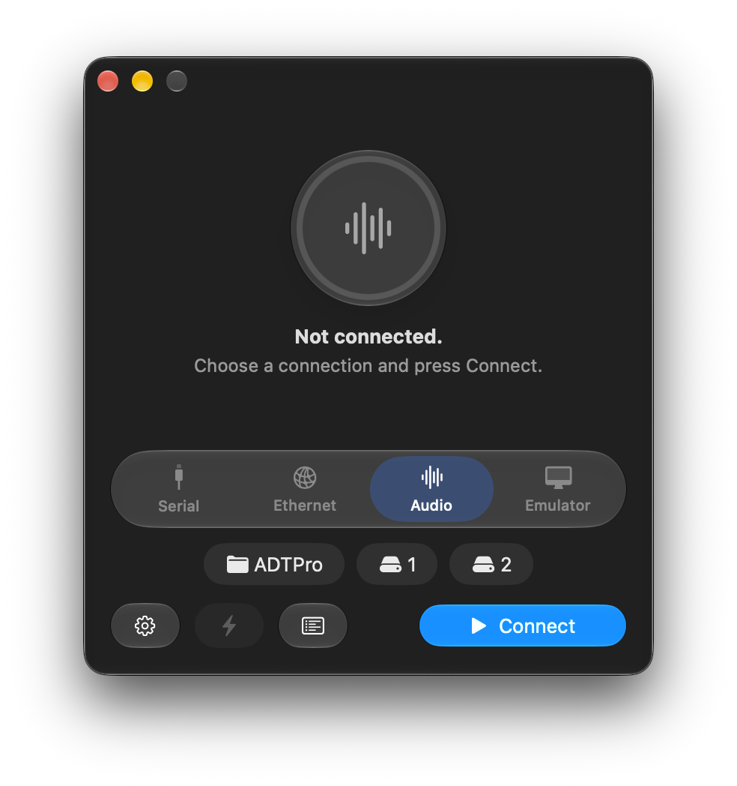

# Got an old Apple computer you want to talk to?

Apple Disk Transfer ProDOS (ADTPro) transfers physical disks and disk images between Apple II-era computers and the modern world. It can even get your Apple running if you don't have any disks at all. The 8-bit Apple (client) component runs on any Apple II or Apple /// compatible computer with 64k of memory or more.

This fork replaces the Java host with a native Swift one: a SwiftUI app on macOS, and a command line host for macOS and Linux. The Apple clients are unchanged and speak the same protocol.

<p align="center">
  
</p>

Read more about ADTPro itself at the [ADTPro.com website](http://adtpro.com).

## Using it

### macOS app (macOS 26 or later)

```sh
make app        # needs xcodegen (brew install xcodegen)
open .build/xcode/Build/Products/Release/ADTPro.app
```

A small Liquid Glass window: pick a connection (Serial, Ethernet, Audio, or Emulator), press **Connect**, and use the folder chip to choose your disk images folder. The drive chips pick virtual drive images, the bolt button bootstraps the Apple once connected, and the log button opens the activity log. To connect at launch: `open ADTPro.app --args -connect serial`.

### Command line (macOS and Linux)

```sh
swift build -c release
.build/release/adtpro ports                                  # serial ports, network addresses, audio devices
.build/release/adtpro serve serial -p /dev/cu.usbserial-1410 -d ~/AppleDisks
.build/release/adtpro serve ethernet                         # Uthernet / LANceGS, UDP port 6502
.build/release/adtpro serve audio
.build/release/adtpro serve serialip --listen                # Virtual ][ (it connects to us, port 1977)
.build/release/adtpro serve serialip --host localhost        # AppleWin / GSport (we connect to them)
```

While serving, type `bootstrap` to list bootstraps (Speediboot, ProDOS, ADTPro clients, EsDOS, ADT, SOS), `cd DIR`, `v1 PATH`/`v2 PATH` to choose virtual drive images, `trace`, or `quit`.

The `disk` subcommand creates and edits ProDOS images, and the client disk build uses it too:

```sh
adtpro disk create Work.po --name WORK --blocks 1600
adtpro disk put Work.po HELLO.BIN --type BIN --aux 0x2000
adtpro disk ls Work.po
adtpro disk convert Game.dsk Game.nib
```

## Building

| Command | What it does |
|---|---|
| `make` / `make test` | Build / test the Swift package |
| `make payloads` | Assemble the 6502 clients into the host's bootstrap payloads (needs [cc65](https://cc65.github.io): `brew install cc65`) |
| `make disks` | Build the distribution client disks into `.build/disks` |
| `make app` | Generate `ADTPro.xcodeproj` from `project.yml` with XcodeGen and build the app (or run `xcodegen` and open the project in Xcode) |
| `make linux-test` | Build and test in a Linux container (needs Docker) |

Built payloads are committed under `Sources/ADTProCore/Resources/Payloads`, so building the host does not need cc65. Run `make payloads` after changing client source. `make disks` starts from the base images in `client/disks` and adds the freshly built clients with `adtpro disk`, so no Java or AppleCommander is involved.

## Layout

| Path | Contents |
|---|---|
| `Sources/DiskImage` | Disk image formats: DOS/ProDOS sector order, 2IMG, nibble (6-and-2 GCR) images, ProDOS volume creation and file placement |
| `Sources/ADTProCore` | The host: wire protocol, transports (termios serial, UDP, serial over TCP, audio modem), bootstrapping, virtual drives |
| `Sources/adtpro` | Command line host and disk tools |
| `App` | SwiftUI macOS app sources and icon |
| `project.yml` | XcodeGen spec for the app; generates `ADTPro.xcodeproj` (not checked in) |
| `Tests` | Unit tests, plus protocol tests that drive the host with a simulated Apple client |
| `client` | The 6502 Apple II / Apple /// clients (unchanged), with `prebuilt/` binaries (ProDOS, BASIC, EsDOS, SOS driver), `disks/` base disk images, `lib/` cc65 and ip65 link libraries, and `tools/` |
| `docs` | Images for this README |
| `archive/java-host` | The original Java host, its Ant build and the adtpro.com website sources, kept for reference (see its README) |

The protocol is documented in `archive/java-host/doc/src/site/apt/protocol.apt` (ADTPro-Wide), `protocolv1.apt` (the original protocol) and `vdrive.apt` (virtual drives).

## Differences from the Java host

The wire protocol is unchanged. On the host side:

- Each emulator gets the right TCP role. Virtual ][ connects out to the host (`--listen`). AppleWin and GSport wait for the host to connect.
- AppleCommander and jSSC are gone. Disk images, serial ports and audio are handled natively, and the client disks are built without Java.
- Virtual drive writes go straight to the one block that changed instead of rewriting the whole image. Images edited on the host are picked up on their next access.
- Names from the Apple are matched case-insensitively on case-sensitive file systems (Linux). Hidden files are left out of directory listings.
- Bugs fixed from the Java code:
  - The nibble track comparison used integer division and compared the wrong bytes.
  - A stale second read could be written into a later nibble track.
  - Sending a disk whose size was not a multiple of 40 blocks could run past the end of the image.
  - The Home packet had the wrong check byte.
  - A failed wide-protocol upload left a partial image behind.

## License

GPL v2 or later, as for ADTPro. See [LICENSE](LICENSE).
